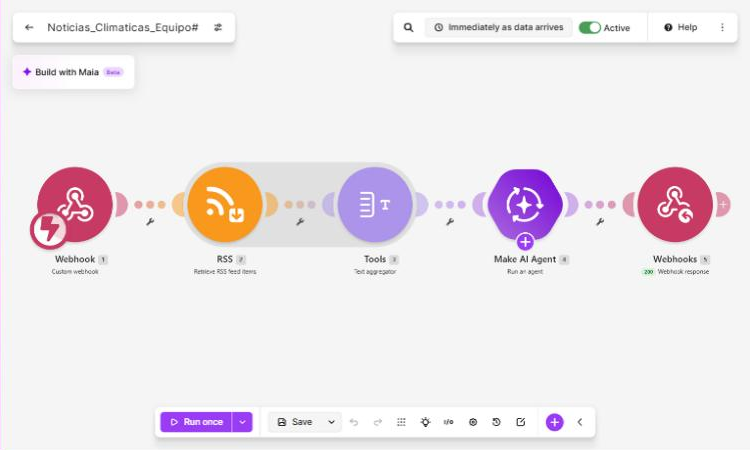
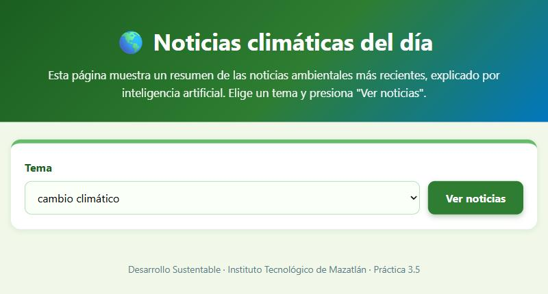
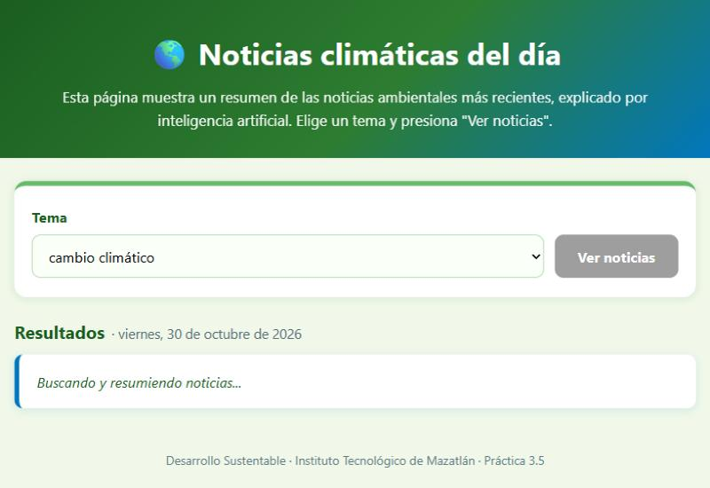
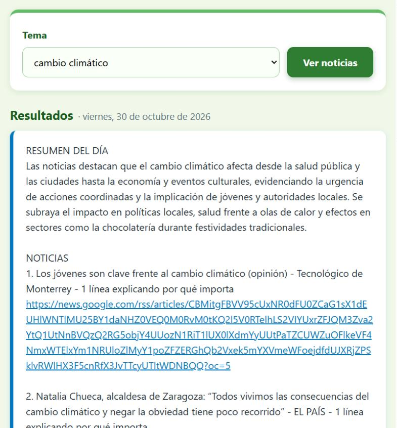
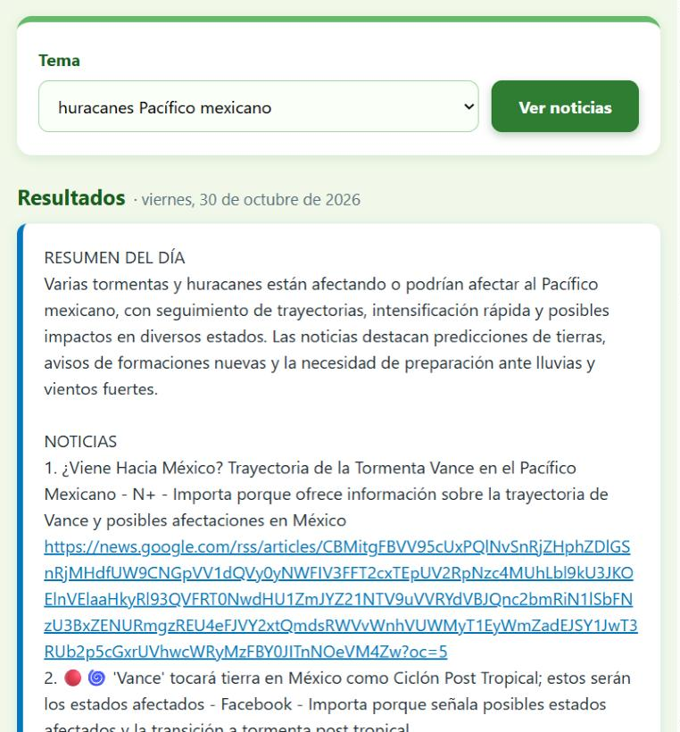
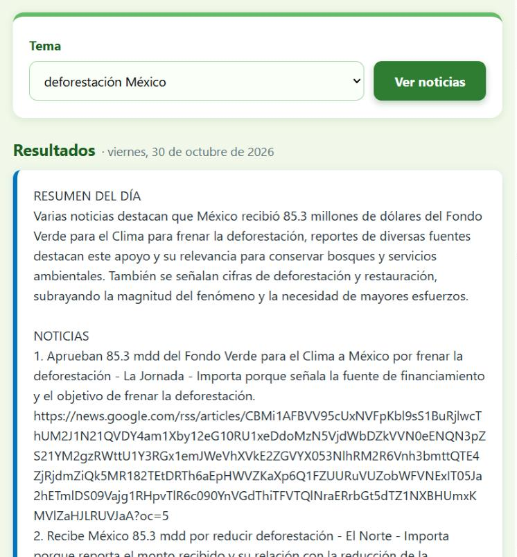
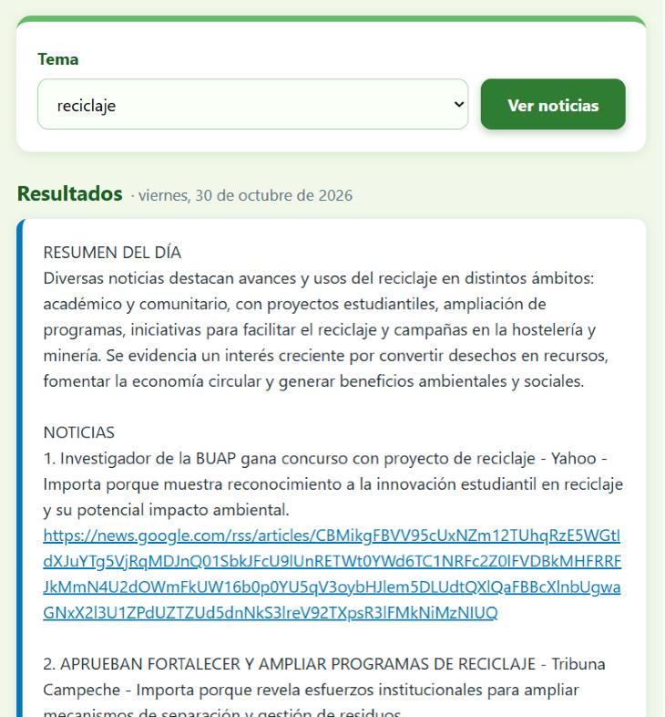
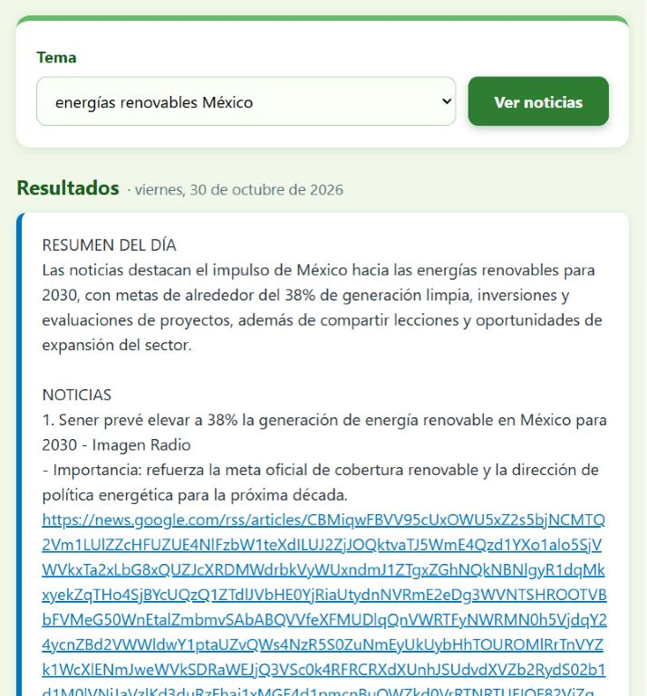
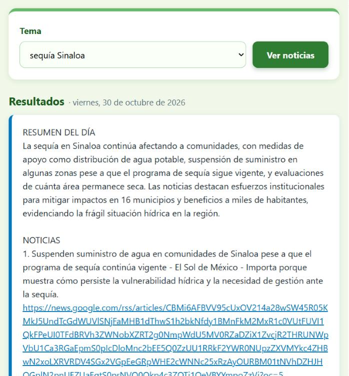
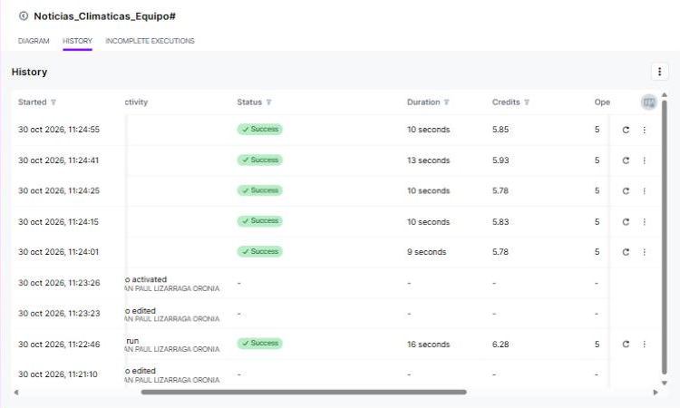

# Noticias climáticas del día

**Materia:** Desarrollo Sustentable · 3er semestre
**Carrera:** Ingeniería en Sistemas Computacionales — Instituto Tecnológico de Mazatlán
**Profesor:** Miguel Ángel Barrón Hernández
**Alumno:** Christian Paul Lizárraga Oronia
**Práctica:** 3.5 – Página web "Noticias climáticas del día"

---

🎥 **Video de la prueba en vivo:** [▶️ Ver video en YouTube](ENLACE_YOUTUBE)

🌐 **Página publicada:** [christiac507.github.io/Noticias-climaticas-del-dia](https://christiac507.github.io/Noticias-climaticas-del-dia/)

## 1. Descripción del proyecto

Cada día se publican cientos de noticias ambientales, pero pocas personas tienen tiempo de leerlas. Esta práctica construye una herramienta de **difusión ambiental**: la página web **"Noticias climáticas del día"**, donde se elige un tema ambiental y se recibe en segundos:

- Un **resumen del día** de 3 a 4 líneas, explicado por inteligencia artificial.
- Las **5 noticias más recientes** de Google News, cada una con una línea de por qué importa y su **enlace a la fuente**.
- Una **acción concreta** que un estudiante puede hacer sobre ese tema.

La página envía el tema al escenario de **Make.com** **"Noticias_Climaticas_Equipo#"**. Ahí se leen las noticias por **RSS**, se juntan en un solo texto, un **Make AI Agent** las resume y la respuesta regresa a la página.

## 2. Estructura del repositorio

```
├── README.md                 ← este reporte técnico
├── index.html                ← página web (GitHub Pages)
├── codigo/
│   └── blueprint.json        ← exportación del escenario de Make.com
├── imagenes/
│   ├── 01_escenario_completo.png
│   ├── 02_pagina_vacia.png
│   ├── 03_buscando_noticias.png
│   ├── 04_cambio_climatico.png … 09_sequia_sinaloa.png
│   └── 10_historial_creditos.png
├── video/
│   ├── enlace.txt            ← link de YouTube con la prueba en vivo
│   └── enlace.md             ← mismo link, clickeable
└── resultados/
    └── Resultados_Noticias_climaticas.pdf
```

## 3. Temas elegidos (Actividad 1)

Se eligieron 6 temas del catálogo: al menos uno de cada bloque A–D y uno local (bloque E). Antes de usarlos se buscaron en Google News (30 de octubre de 2026) para confirmar que tuvieran noticias recientes.

| Bloque | Tema | Noticias en los últimos 7 días |
|--------|------|:------------------------------:|
| A. Cambio climático | **cambio climático** | 82 |
| A. Cambio climático | **huracanes Pacífico mexicano** | 16 |
| B. Impacto humano | **deforestación México** | 6 |
| C. Consumo | **reciclaje** | 90 |
| D. Energía y soluciones | **energías renovables México** | 20 |
| E. Local | **sequía Sinaloa** | 3 |

Se descartaron *olas de calor México*, *desertificación México* y *manglares Sinaloa* porque no tenían ninguna noticia de esa semana.

## 4. Arquitectura del escenario

**Flujo:** Página web → Make (Webhooks → RSS → Text aggregator → Make AI Agent → Webhook Response) → Página web



| # | Módulo | Configuración |
|---|--------|---------------|
| 1 | **Webhooks – Custom webhook** | Webhook `Noticias_Climaticas_Equipo#`. Recibe por POST el campo `tema`. |
| 2 | **RSS – Retrieve RSS feed items** | URL `https://news.google.com/rss/search?q={{encodeURL(1.tema)}}&hl=es-419&gl=MX&ceid=MX:es-419`, máximo **5** noticias. `encodeURL` permite temas con espacios y acentos. |
| 3 | **Tools – Text aggregator** | Source Module: RSS. Junta las 5 noticias en un solo texto (`Título`, `Fecha`, `Enlace`) para que la IA se ejecute **una sola vez** y no cinco. |
| 4 | **Make AI Agent – Run an agent** | Conexión *Make's AI Provider*. Resume las noticias con las instrucciones de la práctica. |
| 5 | **Webhooks – Webhook Response** | Status `200`, Body `{{4.response}}`, headers `Content-Type: text/plain; charset=utf-8` y `Access-Control-Allow-Origin: *`. |

El escenario está activo con **Immediately as data arrives**.

### Text aggregator

```
Título: {{2.title}}
Fecha: {{2.dateCreated}}
Enlace: {{2.url}}
```

### Make AI Agent

**Input:**

```
Tema: {{1.tema}}
Noticias:
{{3.text}}
```

**Instructions:**

```
Eres un divulgador ambiental para alumnos de Desarrollo Sustentable del TecNM.
Recibirás un tema y una lista de noticias recientes (título, fecha y enlace).
Usa ÚNICAMENTE la información de esas noticias; no inventes datos ni agregues noticias que no estén en la lista.
Responde en texto plano (sin asteriscos, sin markdown), en español, con este formato:
RESUMEN DEL DÍA
[3 a 4 líneas explicando de qué tratan las noticias en conjunto]
NOTICIAS
1. [título] - [1 línea explicando por qué importa]
[enlace]
(repite para cada noticia)
¿QUÉ PUEDO HACER YO?
[1 acción concreta que un estudiante puede hacer relacionada con el tema]
Si la lista de noticias viene vacía, responde: "No se encontraron noticias recientes sobre este tema."
```

## 5. Página web

La página se generó con IA usando el prompt de la Actividad 3. Es un solo archivo `index.html`, con CSS y JavaScript incluidos y sin librerías externas:

- Título, breve explicación y la lista desplegable **Tema** con los 6 temas, más el botón **Ver noticias**.
- Envía el tema con `fetch`, método **POST** y **URLSearchParams**, en un solo campo llamado `tema`. No usa JSON ni encabezados personalizados. La URL está en la constante `WEBHOOK_URL`, al inicio del script, con un comentario que indica dónde pegarla.
- Mientras espera muestra *"Buscando y resumiendo noticias..."* y desactiva el botón.
- Muestra la respuesta como texto plano (`white-space: pre-line`) y convierte en **enlaces clicables** que abren en otra pestaña las líneas que empiezan con `http`.
- Muestra la **fecha de hoy** junto al título de los resultados.
- Si hay un error, muestra *"No se pudieron obtener las noticias, intenta de nuevo."*
- Diseño responsive con colores de tema ambiental (verdes y azul).



## 6. Prueba de los 6 temas

Se probaron los 6 temas desde la página publicada en GitHub Pages. Todos respondieron con el formato pedido, en **9 a 14 segundos**.



| | |
|:-:|:-:|
|  |  |
| Cambio climático | Huracanes Pacífico mexicano |
|  |  |
| Deforestación México | Reciclaje |
|  |  |
| Energías renovables México | Sequía Sinaloa |

| Tema | De qué trató el resumen | ¿Qué puedo hacer yo? (IA) |
|------|-------------------------|---------------------------|
| cambio climático | Leyes en el Senado, muertes por calor y efectos en la salud y la economía (chocolate y El Niño). | Proponer en el campus ahorro de energía y reducción de residuos. |
| huracanes Pacífico mexicano | La tormenta Vance y su trayectoria hacia Sinaloa, y la rápida intensificación de huracanes en el Pacífico. | Difundir las recomendaciones de Protección Civil y tener un plan de emergencia. |
| deforestación México | Los 85.3 millones de dólares del Fondo Verde para el Clima y las 178,000 ha deforestadas al año. | Proponer un proyecto de reforestación cerca del campus. |
| reciclaje | Proyectos universitarios, programas oficiales y el intercambio de basura por pasajes ("Recarga Verde"). | Organizar una campaña de reciclaje en la escuela. |
| energías renovables México | La meta de 38 % de energía limpia para 2030 y nuevos proyectos renovables en evaluación. | Crear un club de energías renovables en el campus. |
| sequía Sinaloa | Suspensión del suministro de agua, reparto de agua potable y programas contra la sequía. | Campaña de ahorro de agua y detección de fugas en el campus. |

## 7. Verificación de la IA contra las fuentes

De 3 temas distintos se abrió una noticia original y se comparó con lo que dijo la IA:

| Tema | Noticia | Lo que dijo la IA | Lo que dice la fuente | ¿Es fiel? |
|------|---------|-------------------|-----------------------|:---------:|
| cambio climático | *El cambio climático causó 68 % de las muertes relacionadas al calor entre 2016 y 2023* (Sin Embargo, oct. 2026) | "Subraya el impacto directo en la salud y la mortalidad por calor." | Según el informe Lancet Countdown, más de dos tercios de las muertes por calor son atribuibles al cambio climático: cerca de 3 millones entre 2016 y 2023. | ✅ Sí |
| deforestación México | *México registra una deforestación bruta de 178,000 hectáreas y restaura menos de 35,000* (El Economista, 15 ago. 2026) | "Aporta una cifra sobre la magnitud de la deforestación y los esfuerzos de restauración." | Según la Conafor, entre 2019 y 2024 se deforestaron 1,067,987 ha, unas 177,997 ha al año, y se planea restaurar unas 34,317 ha al año. | ⚠️ Fiel, pero vago |
| sequía Sinaloa | *Sinaloa reduce sequía, pero 26 % del territorio sigue anormalmente seco* (Noroeste, 26 jul. 2026) | "Gran parte del territorio sigue en condiciones secas." | Solo el 26 % del estado sigue anormalmente seco. La nota destaca una **reducción significativa** frente a 2024. | ❌ No |

**Observaciones:**
- En la sequía la IA **exageró**: 26 % no es "gran parte", y cambió el sentido de una nota que habla de mejora.
- En la deforestación fue fiel, pero **no dio las cifras**; solo dijo que la nota "aporta una cifra". Además, 3 de las 5 noticias eran la misma (los 85.3 millones de dólares) publicada por distintos medios.
- Varias noticias **no eran del día**: la de la sequía era de julio y la de la deforestación de agosto. Google News ordena el RSS por relevancia, no por fecha, y la IA las presentó como "noticias recientes".
- En *cambio climático*, un enlace salió cortado al final, así que puede no abrir.

### Créditos

Según el historial del escenario, cada consulta consume **5 operaciones** y entre **5.78 y 5.93 créditos**, unos **5.8 por tema**. Tarda de 9 a 13 segundos. La primera prueba con **Run once** gastó 6.28 créditos.



## 8. Preguntas de reflexión

**1. ¿Qué tema tuvo más noticias recientes y cuál menos? ¿Qué dice eso sobre la atención que los medios dan a cada problema?**
**Reciclaje** tuvo más noticias en la semana (90), seguido de **cambio climático** (82). Los que menos tuvieron fueron **sequía Sinaloa** (3) y **deforestación México** (6). Otros temas como *olas de calor México*, *desertificación* o *manglares Sinaloa* no tuvieron ninguna. Los medios cubren más los temas generales y los que tienen una noticia del momento, como un premio, una ley o una tormenta. Los problemas lentos y locales, como la sequía o la pérdida de bosques y manglares, casi no aparecen, aunque nos afectan todos los días. La atención de los medios no depende de qué tan grave es un problema, sino de qué tan "noticia" es ese día.

**2. ¿Los resúmenes de la IA fueron fieles a las noticias originales? ¿Qué riesgos tiene difundir información resumida por IA sin verificarla?**
**En su mayoría sí**: de 3 noticias verificadas, una fue fiel, otra fiel pero vaga y otra **exagerada**: dijo que "gran parte" de Sinaloa sigue seca cuando la fuente dice 26 % y habla de una mejora. Además, presentó como recientes noticias de hace meses. El riesgo es difundir datos exagerados o viejos como si fueran de hoy. Eso puede causar alarma o desconfianza, y al compartirse sin revisar el error se multiplica. Por eso la página muestra los enlaces a las fuentes: el resumen sirve para orientar, pero hay que leer la nota original antes de compartir un dato.

**3. ¿Qué tan presentes estuvieron los temas locales (Sinaloa, Mazatlán) frente a los nacionales o globales?**
Muy poco. De los temas locales del catálogo, *sequía Sinaloa* tuvo 3 noticias en la semana, *Mazatlán medio ambiente* 2, *pesca sustentable Sinaloa* 1 y *manglares Sinaloa* ninguna. En cambio, los temas nacionales o globales tuvieron decenas. Lo local apareció sobre todo por algo urgente, como la tormenta Vance acercándose a Sinaloa dentro del tema de huracanes. Esto muestra que la información ambiental de nuestra región depende de pocos medios locales, como Noroeste, y que una herramienta así ayuda a encontrarla.

**4. ¿A quién en su comunidad le sería útil esta página y cómo la harían llegar a esas personas?**
- **Compañeros del Tec y maestros:** para estar al día en temas ambientales para clases y proyectos. La compartiría en los grupos de WhatsApp del salón y en Classroom.
- **Familias de Mazatlán:** sobre todo en temporada de huracanes y de sequía, para enterarse rápido de avisos y apoyos. La compartiría en Facebook y en grupos de colonia.
- **Clubes ecológicos y servicio social:** para elegir temas de campañas. Pondría un código QR en carteles del campus.

**5. ¿Qué otra herramienta de automatización podría usar un ingeniero en sistemas para difundir la conciencia ambiental?**
- Un **bot de Telegram o WhatsApp** que mande cada mañana el resumen de un tema, programado en Make con *Every day*.
- Un **boletín por correo** semanal generado automáticamente con las noticias más importantes.
- Publicación automática en **redes sociales**, por ejemplo en la página de Facebook de un club ecológico.
- **Alertas** con datos oficiales de calidad del aire, temperatura o del Monitor de Sequía de Conagua cuando se pase un límite.

## 9. Relación con los ODS

- **ODS 13 – Acción por el clima:** informa sobre cambio climático, huracanes y sequía, y propone acciones.
- **ODS 4 – Educación de calidad:** acerca la información ambiental a estudiantes de forma clara.
- **ODS 12 – Producción y consumo responsables:** temas de reciclaje y energías renovables.
- **ODS 15 – Vida de ecosistemas terrestres:** tema de deforestación.

## 10. Conclusión

Con Make, un feed RSS y un agente de IA se construyó, sin programar el flujo, una página que resume las noticias ambientales del día en unos 10 segundos y con unos 5.8 créditos por consulta. El **Text aggregator** fue clave para que la IA trabajara una sola vez por tema. La práctica también mostró los límites de la IA: casi siempre resumió bien, pero exageró un dato de la sequía en Sinaloa y presentó noticias viejas como recientes. Un ingeniero en sistemas puede ayudar a su comunidad haciendo accesible la información ambiental, siempre que la herramienta muestre las fuentes y la información se verifique antes de difundirla.

## 11. Fuentes

- Práctica 3.5 – Página web "Noticias climáticas del día" (TecNM, Desarrollo Sustentable).
- Google News RSS: https://news.google.com/rss
- Noroeste – *Sinaloa reduce sequía, pero 26 % del territorio sigue anormalmente seco*: https://www.noroeste.com.mx/culiacan/sinaloa-reduce-sequia-pero-26-del-territorio-sigue-anormalmente-seco-IN24386592
- El Economista (vía Yahoo Noticias) – *México registra una deforestación bruta de 178,000 hectáreas y restaura menos de 35,000*: https://es-us.noticias.yahoo.com/m%C3%A9xico-registra-deforestaci%C3%B3n-bruta-178-135953111.html
- Excélsior – *El calor causó tres millones de muertos en el mundo entre 2016 y 2023* (informe Lancet Countdown): https://www.excelsior.com.mx/internacional/calor-causo-tres-millones-muertos-mundo-entre-2016-y-2023
